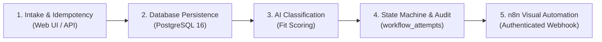

# AI Business Automation Platform

**A portfolio-grade project demonstrating reliable business automation, full-stack engineering, and practical AI integration.**

> 📖 **Looking for the User Guide?** Check out the [User Manual & Operations Guide](USER_MANUAL.md) for a plain-English walkthrough of the dashboard, AI lead qualification, and step-by-step tutorials.

## 1. Project Overview

### The problem

Small businesses often process incoming leads manually. They receive inquiries, validate contact details, research potential customers, classify leads, update their CRM, and notify sales teams.

This process is repetitive, time-consuming, and prone to errors.

### Our solution

Build an AI-powered business automation platform that accepts incoming leads, validates their information, classifies them using an LLM, stores the results, and notifies the appropriate person.

The system must be reliable, secure, testable, and easy to extend.

**Core workflow:**

1. Receive a lead through an API or form.
2. Validate and normalize the submitted data.
3. Detect duplicate submissions.
4. Classify the lead using an LLM.
5. Validate the AI-generated output.
6. Store the lead and classification in a database.
7. Notify the sales team.
8. Record processing history and failures.
9. Retry eligible failures safely without creating duplicate records or notifications.

## 2. Project Goals

This project should demonstrate the ability to:

- Design and implement a maintainable TypeScript backend.
- Build reliable API integrations.
- Integrate LLMs into real business workflows.
- Use n8n for workflow orchestration.
- Design database schemas and enforce data integrity.
- Implement idempotency, retries, and error recovery.
- Write unit, integration, and end-to-end tests.
- Protect API keys and sensitive data.
- Implement CI/CD with GitHub Actions.
- Document architecture and technical trade-offs.
- Deploy and demonstrate a working application.

The goal is not simply to make an AI demo. It is to build a small but credible business system.

## 3. Proposed Technology Stack

Start with a minimal stack and add dependencies only when necessary.

| Area            | Technology                                                                                   |
| --------------- | -------------------------------------------------------------------------------------------- |
| Language        | TypeScript with strict mode                                                                  |
| Runtime         | Supported Node.js LTS                                                                        |
| Backend         | Fastify or another lightweight HTTP framework                                                |
| Validation      | Zod                                                                                          |
| Database        | PostgreSQL                                                                                   |
| Testing         | Vitest                                                                                       |
| Formatting      | Prettier                                                                                     |
| Linting         | ESLint                                                                                       |
| AI              | OpenAI-compatible LLM (OpenAI, Gemini, Groq, Ollama) behind a provider-independent interface |
| Automation      | n8n                                                                                          |
| Version control | Git and GitHub                                                                               |
| CI/CD           | GitHub Actions                                                                               |
| Deployment      | Choose after the local application works                                                     |

### Architectural Decisions Recorded

- **Backend Framework: Fastify (v5)**
  - _Decision:_ Fastify was chosen over Express and NestJS.
  - _Rationale:_ Lightweight, high-throughput, schema-driven, native TypeScript typings, and built-in Pino structured logging. Vitest tests can execute in-memory HTTP requests using `app.inject()` without binding to network ports, preventing port collision in CI.
- **Database Client: Drizzle ORM with PostgreSQL (Milestone 2+)**
  - _Decision:_ Drizzle ORM with `pg` was chosen over Prisma.
  - _Rationale:_ Zero runtime engine overhead (no heavy Rust binary), transparent SQL execution semantics, full control over transactional idempotency patterns (`ON CONFLICT DO NOTHING`, advisory locks), and reviewable `.sql` migrations via `drizzle-kit`.

- **LLM Provider: OpenAI-compatible interface with a config-driven factory**
  - _Decision:_ A single `LeadClassifier` interface backed by a factory that selects the active provider via `LLM_PROVIDER`.
  - _Rationale:_ Any OpenAI-compatible endpoint works with zero code changes by setting `OPENAI_BASE_URL` + `OPENAI_MODEL`. Free options include **Google Gemini** (`gemini-flash-lite-latest`), Groq, and local Ollama. Tests always use the deterministic mock, so CI never makes paid API calls.

Do not introduce Redis, Kafka, Kubernetes, microservices, or vector databases without a demonstrated requirement.

## 4. Milestone Roadmap

### Milestone 0 — Engineering Foundation

**Objective:** Establish a professional development environment.

Tasks:

- [x] Create the repository.
- [x] Initialize the TypeScript project.
- [x] Enable TypeScript strict mode.
- [x] Configure ESLint and Prettier.
- [x] Configure Vitest.
- [x] Create `.gitignore`.
- [x] Create `.env.example` containing placeholders only.
- [x] Add a health-check endpoint.
- [x] Add a basic automated test.
- [x] Configure GitHub Actions.
- [x] Document installation and development commands.

#### Quickstart & Development Commands

```bash
# 1. Install dependencies
npm install

# 2. Check code style and formatting
npm run format:check

# 3. Automatically format code
npm run format

# 4. Run linter
npm run lint

# 5. Type-check with strict TypeScript
npm run typecheck

# 6. Run automated tests (Vitest)
npm test

# 7. Build for production (outputs to dist/)
npm run build

# 8. Start local development server with hot reload
npm run dev

# 9. Start production server
npm start
```

**Acceptance criteria:**

- A fresh checkout can install dependencies.
- Formatting, linting, type-checking, tests, and build succeed.
- No secrets are committed.
- CI runs automatically on pushes and pull requests.

Do not implement AI, database integration, or n8n in this milestone.

### Milestone 1 — Lead Intake API

**Objective:** Receive and validate lead submissions.

Implement an endpoint:

`POST /api/leads`

Example request:

```json
{
  "name": "Jordan Lee",
  "email": "jordan@example.com",
  "company": "Example Co",
  "website": "https://example.com",
  "message": "We need help automating our sales process."
}
```

Tasks:

- [x] Define the lead data model.
- [x] Create request validation schemas.
- [x] Validate email format and required fields.
- [x] Enforce sensible field-length limits.
- [x] Normalize appropriate fields.
- [x] Return consistent success and error responses.
- [x] Add unit tests for validation.
- [x] Add API tests for valid and invalid requests.
- [x] Separate HTTP handling from business logic.

**Acceptance criteria:**

Valid requests are accepted. Invalid requests return predictable 4xx responses. Invalid submissions never trigger downstream processing.

### Milestone 2 — Database and Idempotency

**Objective:** Persist leads reliably.

Tasks:

- [x] Set up PostgreSQL.
- [x] Design the database schema.
- [x] Add database migrations.
- [x] Implement a repository layer.
- [x] Store leads and their processing status.
- [x] Add a durable deduplication or idempotency strategy.
- [x] Test repeated requests.
- [x] Test concurrent duplicate submissions.
- [x] Handle database failures safely.

**Acceptance criteria:**

Repeated requests do not create duplicate lead records. Database constraints enforce important invariants instead of relying solely on application code.

### Milestone 3 — AI Lead Classification

**Objective:** Integrate an LLM safely and predictably.

The AI should classify a lead using the supplied information.

Example output:

```json
{
  "category": "high_fit",
  "score": 85,
  "reasoning_summary": "The lead describes a clear business automation need.",
  "recommended_action": "schedule_follow_up"
}
```

Use controlled categories and actions rather than unrestricted model-generated commands.

Tasks:

- [x] Create a provider-independent `LeadClassifier` interface.
- [x] Define a structured output schema.
- [x] Implement the LLM provider adapter.
- [x] Write and version the classification prompt.
- [x] Validate the returned output at runtime.
- [x] Handle timeouts and rate limits.
- [x] Handle malformed or invalid model output.
- [x] Add configurable retry limits.
- [x] Add cost and token limits.
- [x] Create deterministic mock-based tests.
- [x] Keep API keys on the server.

**Acceptance criteria:**

The application accepts only schema-valid AI output. Failed classifications are recorded explicitly. Invalid output cannot bypass business rules.

### Milestone 4 — Workflow Orchestration and Notifications

**Objective:** Complete the lead-processing workflow.

Tasks:

- [x] Define explicit processing states.
- [x] Implement the lead-processing use case.
- [x] Add a notification adapter.
- [x] Start with a development notification sink or test provider.
- [x] Implement bounded retries with backoff.
- [x] Distinguish transient and permanent errors.
- [x] Record processing attempts.
- [x] Prevent duplicate notifications on retries.
- [x] Add a way to inspect failed jobs.
- [x] Add integration tests for failure recovery.

Possible states:

`received → validated → classifying → classified → notification_pending → completed`

Failed work should transition to an appropriate failure or review state.

Use a transactional outbox or equivalent durable pattern if needed to coordinate database changes and external notifications reliably.

**Acceptance criteria:**

A lead can complete the workflow. Transient failures can be retried safely, and permanent failures remain visible for investigation.

### Milestone 5 — n8n Integration

**Objective:** Introduce workflow automation without hiding business logic inside an untestable visual workflow.

Tasks:

- [x] Run n8n locally.
- [x] Design the workflow boundaries.
- [x] Connect n8n to the backend using authenticated webhooks.
- [x] Validate every incoming webhook payload.
- [x] Handle duplicate deliveries.
- [x] Store credentials securely.
- [x] Export a sanitized workflow into `workflows/`.
- [x] Document how to import and execute it.
- [x] Test failures and retries.

Keep critical business rules in the backend. Use n8n for orchestration and integrations where it provides a clear benefit.

**Acceptance criteria:**

Another developer can reproduce the workflow from the documentation. Exported workflow files contain no secrets.

### Milestone 6 — Security and Observability

**Objective:** Make failures diagnosable and reduce security risks.

Tasks:

- [x] Add structured logging.
- [x] Add request or correlation IDs.
- [x] Redact secrets and unnecessary personal information.
- [x] Validate environment variables at startup.
- [x] Add sensible request-size limits and timeouts.
- [x] Add rate limiting where appropriate.
- [x] Review webhook authentication.
- [x] Review database access controls.
- [x] Test provider outages and timeout behavior.
- [x] Document data retention and deletion.
- [x] Review dependencies and enable appropriate security scanning.

**Acceptance criteria:**

The system provides useful diagnostic information without exposing credentials or unnecessary sensitive data.

### Milestone 7 — Deployment and Portfolio Release

**Objective:** Make the project easy to run, evaluate, and understand.

Tasks:

- [x] Select a suitable deployment target.
- [x] Configure environment variables securely.
- [x] Document database setup and migrations.
- [x] Deploy a demo where practical.
- [x] Add an architecture diagram.
- [x] Add API examples.
- [x] Add screenshots or a short demo video.
- [x] Document trade-offs and known limitations.
- [x] Add a troubleshooting guide.
- [x] Tag a release after CI passes.

**Acceptance criteria:**

A reviewer can understand the architecture, reproduce the workflow, inspect the tests, and see how important failures are handled.

## 5. Proposed Project Structure

Start small and introduce folders when they are needed.

```text
ai-business-automation/
├── src/
│   ├── app/
│   ├── config/
│   ├── domain/
│   │   ├── leads/
│   │   ├── classification/
│   │   └── workflows/
│   ├── services/
│   ├── adapters/
│   │   ├── database/
│   │   ├── llm/
│   │   └── notifications/
│   ├── http/
│   │   ├── routes/
│   │   ├── middleware/
│   │   └── schemas/
│   └── observability/
├── tests/
│   ├── unit/
│   ├── integration/
│   └── fixtures/
├── workflows/
├── docs/
│   ├── architecture.md
│   ├── runbook.md
│   ├── troubleshooting.md
│   ├── security.md
│   ├── data-retention.md
│   └── adr/
├── .github/
│   └── workflows/
├── .env.example
├── .gitignore
├── package.json
├── tsconfig.json
└── README.md
```

This is a target structure, not a requirement to create empty files and folders immediately.

Keep domain logic testable without starting an HTTP server, calling a paid LLM, or contacting an external service.

## 6. API and Error Handling Principles

Use consistent response formats.

Example error:

```json
{
  "error": {
    "code": "VALIDATION_ERROR",
    "message": "The request contains invalid fields.",
    "correlationId": "request-id"
  }
}
```

Rules:

- Never expose stack traces to API clients.
- Never expose API keys, internal database errors, or sensitive prompts.
- Use appropriate HTTP status codes.
- Return a stable error code for programmatic handling.
- Distinguish synchronous processing from queued processing.
- Do not report completion until the persisted workflow state confirms completion.

## 7. Reliability Requirements

These are core requirements, not optional enhancements.

### Idempotency

Assume clients and workflow engines can deliver the same request multiple times.

Use durable database-backed idempotency or deduplication. An in-memory check is insufficient for a production service.

### Retries

Retry only eligible failures, with bounded attempts and backoff. Invalid input should not be retried indefinitely.

### LLM safety

Treat LLM output as untrusted input. Validate structured results and never execute arbitrary model-generated instructions.

### Cost controls

Configure timeouts, token limits, retry limits, and usage budgets. Avoid repeated paid calls when a previous result can safely be reused.

### Observability

Record state transitions, processing attempts, and failure reasons. Include correlation IDs, but do not log secrets.

### External side effects

A timeout does not always mean an external provider failed to process a request. Use provider-supported idempotency features where available and document any remaining uncertainty.

## 8. Testing Strategy

### Unit tests

Test:

- Input validation.
- Data normalization.
- Classification schema validation.
- Business rules.
- Workflow state transitions.
- Retry decisions.
- Error mapping.

### Integration tests

Test:

- API requests against a test database.
- Database constraints.
- Migrations.
- Duplicate requests.
- Failure recovery.

### End-to-end tests

Submit a lead and verify its persisted status and notification outcome using controlled test adapters.

### CI rules

The default CI suite must not depend on paid LLM calls, live email accounts, or real production credentials.

Use deterministic mocks and test fixtures. Add separately configured smoke tests for real integrations only when needed.

## 9. Security Checklist

- [x] `.env` and secret files are ignored by Git.
- [x] `.env.example` contains placeholders only.
- [x] No credentials appear in source code or logs.
- [x] Inputs have schema and length validation.
- [x] Provider requests have timeouts and response-size limits.
- [x] Webhooks are authenticated.
- [x] Database queries use parameterized access through the chosen client.
- [x] Administrative endpoints require appropriate authorization.
- [x] Personal information is logged only when necessary.
- [x] Dependencies and secrets are scanned where practical.

## 10. Git and Development Workflow

For each feature:

1. Write acceptance criteria.
2. Inspect the existing code.
3. Agree on a minimal design.
4. Implement one small, coherent change.
5. Add or update tests.
6. Run formatting, linting, type-checking, tests, and build.
7. Review the diff for accidental changes and secrets.
8. Update documentation.
9. Commit with a descriptive message.

Examples:

```text
chore: initialize TypeScript service
feat: validate incoming leads
test: cover invalid lead payloads
feat: persist leads with idempotency
feat: add structured lead classification
fix: prevent duplicate notifications on retry
```

## 11. Rules for the Coding Agent

Work on **one milestone at a time**. Never ask the agent to implement the entire roadmap in one operation.

For each task, the agent must:

- Inspect the repository before editing.
- Explain the existing architecture relevant to the task.
- State assumptions and acceptance criteria.
- Propose the smallest reasonable implementation.
- Explain major dependency or architecture choices.
- Write tests for success and failure cases.
- Run relevant checks and report actual results.
- List changed files and remaining risks.
- Avoid unrelated refactors.
- Never invent test results or claim a command passed unless it ran.
- Never commit secrets or use production credentials.
- Ask before introducing significant new infrastructure.

## 12. Definition of Done

A feature is complete only when:

- [x] Its acceptance criteria are met.
- [x] Important success and failure paths are tested.
- [x] Relevant automated checks pass.
- [x] Errors are handled intentionally.
- [x] No secrets or unnecessary sensitive data are exposed.
- [x] Documentation matches the actual behavior.
- [x] The code diff contains no unrelated changes.
- [x] The agent's report has been verified.

## 13. Final Portfolio Deliverables & Documentation Index

The complete documentation suite is available under the `docs/` and `workflows/` directories:

- **[Getting Started — Connect, Use & Test](docs/getting-started.md)**: Step-by-step setup, n8n connection, and full test walkthrough.
- **[System Architecture](docs/architecture.md)**: Detailed component diagrams, sequence flows, and layer responsibilities.
- **[Operations Runbook](docs/runbook.md)**: Deployment instructions, environment variables, database migrations, and API reference.
- **[Troubleshooting & Incident Recovery](docs/troubleshooting.md)**: Triage workflows, error codes, failed lead inspection, and recovery procedures.
- **[Security Architecture & Controls](docs/security.md)**: Threat modeling, timing-safe authentication, rate limits, and vulnerability auditing.
- **[Data Retention & Privacy Policy](docs/data-retention.md)**: 90-day retention schedules, GDPR Right to Erasure, and automated cleanup scripts.
- **[n8n Workflow Integration](workflows/README.md)**: Import guide and zero-secret sanitized workflow template (`workflows/lead-automation-workflow.json`).

### Architecture Decision Records (ADRs)

- **[ADR 0001: Fastify Application Kernel](docs/adr/0001-fastify-kernel.md)**
- **[ADR 0002: PostgreSQL, Drizzle ORM, and Atomic Idempotency](docs/adr/0002-drizzle-postgresql-idempotency.md)**
- **[ADR 0003: Provider-Agnostic LLM Interface and Schema Validation](docs/adr/0003-provider-agnostic-llm-classifier.md)**
- **[ADR 0004: Two-Phase Workflow Orchestration and Audit Trail](docs/adr/0004-two-phase-orchestration-and-audit.md)**
- **[ADR 0005: Boundary-Enforced n8n Workflow Integration](docs/adr/0005-n8n-webhook-integration.md)**
- **[ADR 0006: Security Hardening, Rate Limiting, and Log Redaction](docs/adr/0006-security-hardening-and-redaction.md)**

---

## 14. Quickstart Guide

### One-Command Deployment (Docker Compose)

```bash
# 1. Spin up PostgreSQL 16, n8n, and the application service
docker compose up -d --build

# 2. Verify all services are healthy
docker compose ps

# 3. Check application health
curl -s http://localhost:3000/health | jq .
```

### Local Development

```bash
# 1. Start database container
docker compose up postgres -d

# 2. Install dependencies
npm install

# 3. Apply database migrations
npm run db:migrate

# 4. Start local development server
npm run dev

# 5. Run automated test suite
npm test
```

---

## 15. API Examples & Sample Payloads

### Submit Lead (`POST /api/leads`)

```bash
curl -X POST http://localhost:3000/api/leads \
  -H "Content-Type: application/json" \
  -H "Idempotency-Key: test-lead-001" \
  -d '{
    "name": "Jordan Lee",
    "email": "jordan@example.com",
    "company": "Example Co",
    "website": "https://example.com",
    "message": "We need help automating our sales onboarding process."
  }'
```

**Response (`201 Created`):**

```json
{
  "lead": {
    "id": "e4b3c2a1-0000-4000-8000-000000000001",
    "name": "Jordan Lee",
    "email": "jordan@example.com",
    "company": "Example Co",
    "website": "https://example.com",
    "message": "We need help automating our sales onboarding process.",
    "status": "received",
    "idempotencyKey": "test-lead-001",
    "createdAt": "2026-10-13T12:00:00.000Z",
    "updatedAt": "2026-10-13T12:00:00.000Z"
  },
  "isDuplicate": false
}
```

### Process Lead (`POST /api/leads/:id/process`)

```bash
curl -X POST http://localhost:3000/api/leads/e4b3c2a1-0000-4000-8000-000000000001/process
```

**Response (`200 OK`):**

```json
{
  "lead": {
    "id": "e4b3c2a1-0000-4000-8000-000000000001",
    "name": "Jordan Lee",
    "email": "jordan@example.com",
    "status": "completed",
    "fitScore": 85,
    "category": "high_fit",
    "reasoningSummary": "Clear business automation inquiry with concrete operational scope.",
    "recommendedAction": "schedule_follow_up",
    "notificationSent": true
  }
}
```

---

## 16. Technical Retrospective & Trade-Offs

### 1. In-Process State Machine vs. Distributed Message Queues (Kafka / Redis)

- **Trade-off**: The platform utilizes a PostgreSQL-backed state machine and durable `workflow_attempts` table rather than introducing Kafka or BullMQ/Redis.
- **Rationale**: For initial B2B lead volumes (hundreds to low thousands daily), an in-process orchestrator backed by PostgreSQL transactions eliminates operational complexity, reduces infrastructure cost to a single database node, and ensures strictly consistent ACID writes.
- **Future Scale**: As lead volumes exceed 100 requests per second, the state machine boundaries and repository interfaces are designed to transition smoothly to an asynchronous job queue (e.g. pg-boss or RabbitMQ) without modifying domain validation rules.

### 2. Drizzle ORM vs. Prisma

- **Trade-off**: Drizzle ORM was chosen over Prisma.
- **Rationale**: Drizzle compiles to lightweight native SQL without Prisma's Rust query-engine binary overhead. This drastically accelerates cold starts in container environments and eliminates binary incompatibility risks under strict NodeNext ESM.

### 3. Provider-Agnostic LLM Isolation

- **Trade-off**: Writing custom fetch-based adapters (`OpenAiCompatibleClassifier`, `MockLeadClassifier`) rather than pulling large SDK frameworks (LangChain / LlamaIndex).
- **Rationale**: Minimal attack surface, zero extraneous dependencies, predictable token spend, and standard `AbortController` timeouts. The default test suite achieves 100% test coverage deterministically without external network calls or paid API keys.

---

## 17. End-to-End Testing & Automation Verification Playbook

This playbook provides a complete walkthrough to test every component of the platform locally and verify whether each automation step is working.



---

### Step 1: Confirm Running Services

Verify that all three Docker containers are running and healthy:

```bash
docker compose ps
```

You should see:

- `ai_business_automation_api`: Running on `http://localhost:3000` (healthy)
- `ai_business_automation_n8n`: Running on `http://localhost:5678`
- `ai_business_automation_postgres`: Running on `localhost:5432` (healthy)

---

### Step 2: Test via the Web Dashboard UI (`http://localhost:3000`)

Open **[http://localhost:3000](http://localhost:3000)** in your browser.

1. **Test Lead Intake**:
   - Click the **"High Fit Sample"** button on the left card (auto-fills prospect Jordan Lee).
   - Click the blue **"Submit Lead"** button.
   - **Verification**:
     - A green banner confirms: `✅ Lead Created: Successfully persisted to PostgreSQL`.
     - A new row appears in the pipeline table on the right with status `RECEIVED`.

2. **Test Idempotency & Deduplication**:
   - Without changing any fields, click **"Submit Lead"** a second time.
   - **Verification**:
     - A yellow banner appears: `⚡ Idempotent Replay: Duplicate submission detected! Existing lead returned with 0 side-effects`.
     - Check the table on the right: **no duplicate row is created**.

3. **Test AI Classification & State Machine**:
   - In the pipeline table, click the blue **"⚡ Process"** button on Jordan's row.
   - **Verification**:
     - Status updates live from `RECEIVED` ➔ `CLASSIFYING` ➔ `COMPLETED`.
     - The **AI Fit Meter** displays `85 (high_fit)` with a green progress bar.
     - The **Action Recommended** pill displays `schedule_follow_up`.

4. **Test Audit Trail & History**:
   - Click the gray **"📜 Audit"** button on Jordan's row.
   - **Verification**:
     - A modal appears showing all steps durably recorded in PostgreSQL:
       - **Step 1: CLASSIFICATION** (Attempt #1, `success`, fit score metadata).
       - **Step 2: NOTIFICATION** (Attempt #1, `success`, message delivery ID).

---

### Step 3: Test the n8n Visual Workflow (`http://localhost:5678`)

The platform includes a pre-built, sanitized visual workflow in [`workflows/lead-automation-workflow.json`](workflows/lead-automation-workflow.json).

1. **Open n8n in Your Browser**:
   Navigate to **[http://localhost:5678](http://localhost:5678)**. Complete the one-time owner setup (or skip).

2. **Import the Workflow**:
   - In the n8n top-left menu, click **Workflows** ➔ **Import from File**.
   - Select the file [`workflows/lead-automation-workflow.json`](workflows/lead-automation-workflow.json).
   - The visual canvas will render the 7 nodes:
     $$\text{Webhook Trigger} \longrightarrow \text{Backend Gateway} \longrightarrow \text{Category Router} \longrightarrow \text{Sales Alert}$$

3. **Activate the Workflow**:
   - Toggle the switch in the upper-right corner to **Active** (or click **"Test workflow"** to listen for a single event).

4. **Trigger the n8n Event via curl**:
   In your terminal, send a lead directly to the n8n webhook:

   ```bash
   curl -i -X POST http://localhost:5678/webhook/leads \
     -H "Content-Type: application/json" \
     -d '{
       "name": "Jane Doe",
       "email": "jane@enterprise.com",
       "company": "Enterprise Corp",
       "website": "https://enterprise.com",
       "message": "Urgent need for automated sales operations and lead classification."
     }'
   ```

5. **How to Verify it Worked in n8n**:
   - In n8n, click **Executions** on the left navigation bar.
   - You will see a green checkmark execution.
   - Click it to view the active path highlighted in green across the canvas:
     - `Incoming Lead Webhook` received the JSON payload.
     - `Send to Backend Gateway` forwarded it with the timing-safe `X-Webhook-Secret`.
     - `Route by Category` matched `high_fit`.
     - `Dispatch Sales Alert` dispatched the notification.
   - Refresh your Web Dashboard at **[http://localhost:3000](http://localhost:3000)**: Jane Doe will now appear in PostgreSQL!

---

### Step 4: Test Inbound Webhook Security (Timing-Safe Auth)

Test the backend webhook endpoint directly to verify authentication and timing attack protections:

1. **Authorized Request (Valid Secret)**:

   ```bash
   curl -i -X POST http://localhost:3000/api/webhooks/n8n/leads \
     -H "Content-Type: application/json" \
     -H "X-Webhook-Secret: dev-webhook-secret-change-in-production" \
     -d '{
       "name": "Taylor Swift",
       "email": "taylor@music.com",
       "message": "Production automation inquiry."
     }'
   ```

   _Expected Response_: `HTTP/1.1 200 OK` with JSON `{ "success": true, "status": "completed" }`.

2. **Unauthorized Request (Invalid Secret)**:
   ```bash
   curl -i -X POST http://localhost:3000/api/webhooks/n8n/leads \
     -H "Content-Type: application/json" \
     -H "X-Webhook-Secret: wrong-secret-token" \
     -d '{
       "name": "Attacker",
       "email": "attacker@evil.com",
       "message": "Unauthorized payload."
     }'
   ```
   _Expected Response_: `HTTP/1.1 401 Unauthorized` with `{ "error": { "code": "UNAUTHORIZED" } }`.

---

### Step 5: Verify the Database (PostgreSQL Inspection)

Verify that data is correctly and safely persisted in PostgreSQL:

1. **Inspect Leads Table**:

   ```bash
   docker compose exec postgres psql -U postgres -d ai_business_automation -c \
     "SELECT id, name, email, status, fit_score, category, notification_sent FROM leads;"
   ```

2. **Inspect Immutable Audit Trail (`workflow_attempts`)**:
   ```bash
   docker compose exec postgres psql -U postgres -d ai_business_automation -c \
     "SELECT lead_id, step, attempt_number, status, metadata FROM workflow_attempts;"
   ```

---

### Step 6: Verify Structured Logging & Sensitive Data Redaction

View the live structured JSON logs emitted by Fastify and Pino:

```bash
docker compose logs api --tail=30
```

**Verification Checklist**:

- Every request contains a unique `reqId` UUID correlation ID.
- Request method, URL, and response time metrics are recorded in milliseconds.
- Sensitive headers (`authorization`, `x-webhook-secret`, `cookie`) and keys (`apiKey`, `password`, `token`) are automatically censored to `"[REDACTED]"`.

---

### Step 7: Test Fault Tolerance, Failure Triage & Retries

1. **Input Validation Rejection (`400 BAD_REQUEST`)**:

   ```bash
   curl -i -X POST http://localhost:3000/api/leads \
     -H "Content-Type: application/json" \
     -d '{"name": "No Email", "message": "Missing email field"}'
   ```

   _Expected Response_: `HTTP/1.1 400 Bad Request` with `VALIDATION_ERROR` detailing the missing email.

2. **Request Payload Cap (`413 PAYLOAD_TOO_LARGE`)**:
   Payloads exceeding 100 KB are automatically rejected with `HTTP 413` to protect memory.

3. **Inspect Failed Leads Queue**:

   ```bash
   curl -s http://localhost:3000/api/leads/failed | jq .
   ```

4. **Retry a Failed Lead**:
   ```bash
   curl -i -X POST http://localhost:3000/api/leads/<LEAD_ID>/retry
   ```

---

### Step 8: Run the Automated Test Suite

Run the full automated test suite containing 56 unit and integration tests:

```bash
npm test
```

_Expected output_: `56 passed (56)` across 10 test files with 100% test pass rate.
