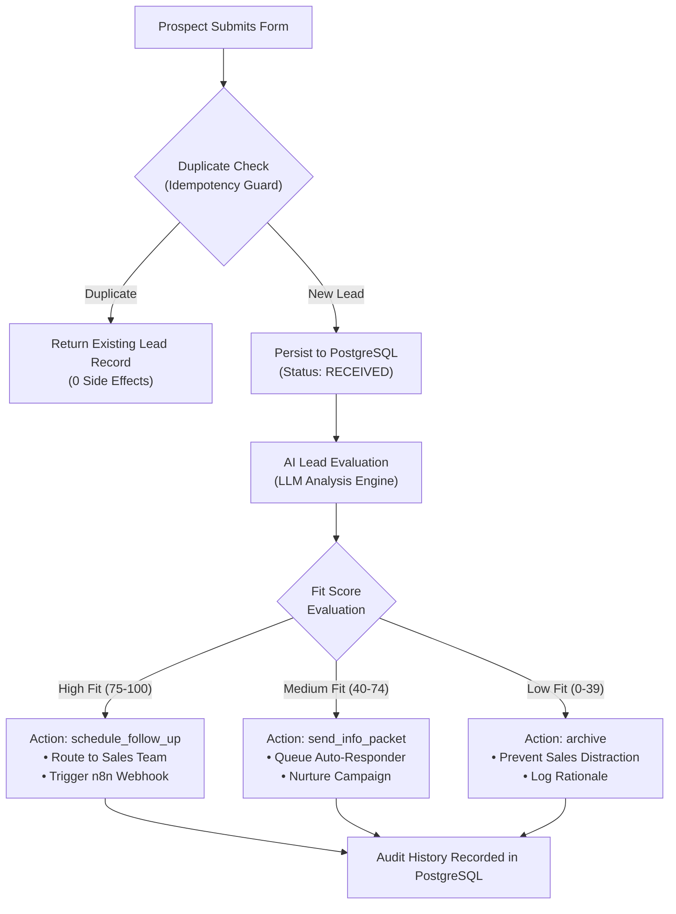

# AI Business Automation Platform — User Manual & Operations Guide

Welcome to the **AI Business Automation Platform**. This manual is designed for business operators, sales managers, and administrators who want to understand how the platform works and how to use it day-to-day.

---

## 1. Platform Overview

### What Business Problem Does This Solve?

When prospective clients visit your company website and fill out a "Contact Us" or "Request Demo" form, sales teams face three common bottlenecks:

1. **Manual Sorting**: High-value enterprise buyers are mixed in with students, hobbyists, and solicitations.
2. **Slow Response Times**: High-fit buyers wait hours or days for a salesperson to review their inquiry, decreasing deal conversion rates.
3. **Data Quality & Spam**: Double-clicks, accidental re-submissions, and bot spam clutter the CRM with duplicate records.

### How This Platform Solves It

This platform provides an automated, AI-driven sales qualification and routing engine:

- **Instant Intake**: Captures lead details deterministically.
- **Idempotency Guard**: Intercepts duplicate clicks, ensuring zero duplicated rows or redundant sales alerts.
- **AI Fit Evaluation**: Automatically analyzes company size, domain, and business requirements to generate an objective fit score from 0 to 100.
- **Automated Dispatch**: Routes qualified leads immediately to sales notification channels and visual automation workflows in **n8n**.
- **Immutable Audit Trail**: Logs every step in PostgreSQL with timestamps and execution metadata.



---

## 2. Accessing the Platform

The entire system runs locally via Docker. Ensure the containers are running, then open the following URLs in your web browser:

| Portal                           | URL                                                          | Description                                                                        |
| :------------------------------- | :----------------------------------------------------------- | :--------------------------------------------------------------------------------- |
| **Interactive Dashboard**        | [http://localhost:3000](http://localhost:3000)               | Primary operator console for lead intake, AI scoring, and pipeline tracking.       |
| **Visual Workflow Engine (n8n)** | [http://localhost:5678](http://localhost:5678)               | Visual drag-and-drop workflow canvas for notifications, Slack pings, and CRM sync. |
| **System Health Check**          | [http://localhost:3000/health](http://localhost:3000/health) | Real-time diagnostic endpoint for database and service connectivity.               |

---

## 3. Interactive Dashboard Walkthrough

When you navigate to **`http://localhost:3000`**, you will see two main panels:

```
+------------------------------------------+-------------------------------------------------------------+
|        Submit Inbound Lead (Left)        |              Live Lead Automation Pipeline (Right)          |
|                                          |                                                             |
| [🚀 1-Click Test Lead]                   | [🔄 Refresh]                                                |
| [High Fit Sample] [Medium Fit Sample]    |                                                             |
|                                          | Prospect          Status      AI Fit       Action   Actions |
| Prospect Name:   [ Jordan Lee         ]  | ----------------------------------------------------------- |
| Work Email:      [ jordan@enterprise  ]  | Bruce Wayne       RECEIVED    Unclassified -        [⚡Process]|
| Company Name:    [ Acme Automations   ]  | Test Prospect     COMPLETED   88 (high)    FollowUp [📜Audit] |
| Website:         [ https://example.com]  | Tommy Student     COMPLETED   30 (low)     Archive  [📜Audit] |
| Business Need:   [ We need automation ]  |                                                             |
| Idempotency Key: [ key-9x8a7b        ]  |                                                             |
|                                          |                                                             |
| [ Submit Lead (POST /api/leads)        ] |                                                             |
+------------------------------------------+-------------------------------------------------------------+
```

### Left Panel: Incoming Lead Intake

- **`🚀 1-Click Test Lead` Button**: Automatically generates a brand-new, unique prospect with realistic enterprise requirements and submits it immediately. Perfect for quick demonstrations.
- **`High Fit Sample` & `Medium Fit Sample`**: Pre-populates the input fields with typical customer inquiry profiles.
- **Form Inputs**:
  - **Prospect Name**: Full name of the contact.
  - **Work Email**: Business email address (validated for RFC compliance).
  - **Company Name** _(Optional)_: Name of the organization.
  - **Company Website** _(Optional)_: Web URL of the business.
  - **Inquiry / Business Need**: Free-form text describing their project, volume, or automation requirements.
  - **Idempotency Key**: Unique submission identifier (auto-generated by default). Prevents accidental double-submissions.
- **Submit Button**: Posts the lead to `/api/leads`. Upon submission, a floating green toast notification slides in at the top right, and the alert box confirms persistence.

### Right Panel: Live Pipeline Table

- **Prospect**: Contact name, work email, and company name.
- **Status Badge**:
  - <span style="color:#60a5fa">**RECEIVED**</span>: Lead has been safely persisted in PostgreSQL; awaiting AI classification.
  - <span style="color:#fbbf24">**CLASSIFYING**</span>: AI evaluation is actively executing.
  - <span style="color:#34d399">**COMPLETED**</span>: AI fit evaluation complete and sales notifications dispatched.
  - <span style="color:#f87171">**FAILED**</span>: Transient error encountered (eligible for 1-click retry).
- **AI Classification**: Visual meter bar showing the calculated fit score (0–100) and category (`high_fit`, `medium_fit`, `low_fit`).
- **Action Recommended**: Next step determined by AI (`schedule_follow_up`, `send_info_packet`, `archive`).
- **Action Buttons**:
  - **`⚡ Process`**: Triggers real-time AI scoring for newly received leads.
  - **`⚡ Re-check`**: Re-evaluates completed leads to verify scoring consistency and trigger alerts.
  - **`🔄 Retry`**: Resumes a failed workflow attempt with exponential backoff protection.
  - **`📜 Audit`**: Opens the immutable history modal detailing every execution attempt.

---

## 4. How the AI Lead Scoring Engine Works

The AI evaluation engine uses structured prompt guardrails to prevent bias and ensure consistent scoring. Every incoming lead is evaluated across four core criteria:

| Evaluation Dimension     | Weight | What the AI Analyzes                                                               |
| :----------------------- | :----- | :--------------------------------------------------------------------------------- |
| **Commercial Intent**    | 35%    | Is there an explicit business need, automation project, or purchasing intent?      |
| **Organizational Scale** | 25%    | Signals of company size, user count (e.g., "150 sales reps"), or budget authority. |
| **Domain Alignment**     | 25%    | Does the problem match business automation, CRM routing, or AI workflows?          |
| **Inquiry Clarity**      | 15%    | Detailed, professional problem statement vs. vague single-word inquiries.          |

### Classification Tiers & Actions

```
Score:  0 ------------------ 40 ------------------ 75 ----------------- 100
Tier:        LOW FIT               MEDIUM FIT                HIGH FIT
Action:      archive            send_info_packet        schedule_follow_up
Routing:  Silent Archive       Marketing Nurture        Direct Sales Priority
```

1. **High Fit (Score: 75–100)**:
   - **Action**: `schedule_follow_up`
   - **Example**: _"We have 250 sales reps and urgently need an automated AI classification and lead routing engine."_
   - **Outcome**: High-priority alert dispatched to sales channels with reasoning summary.
2. **Medium Fit (Score: 40–74)**:
   - **Action**: `send_info_packet`
   - **Example**: _"Just curious about your product features and standard pricing plans."_
   - **Outcome**: Routed to automated marketing nurture sequence.
3. **Low Fit (Score: 0–39)**:
   - **Action**: `archive`
   - **Example**: _"Can I get a free trial to do a school homework presentation?"_
   - **Outcome**: Preserved in database with reasoning summary, but suppresses sales alerts to prevent noise.

---

## 5. Step-by-Step Operator Tutorials

### Tutorial 1: Process a New Prospect

1. Go to `http://localhost:3000`.
2. Click **`🚀 1-Click Test Lead`** at the top of the intake card.
3. Notice the floating green notification: `✅ Lead Created Successfully!`.
4. In the Pipeline Table on the right, find your newly submitted lead with status **`RECEIVED`**.
5. Click the blue **`⚡ Process`** button on that row.
6. Observe the status change to **`COMPLETED`**, the green AI Fit bar fill to **`88 (high_fit)`**, and the action update to **`schedule_follow_up`**.

### Tutorial 2: Test Duplicate Click Protection

1. Fill out the intake form on the left with any details.
2. Click **"Submit Lead"** once. You will see the green success message.
3. Immediately click **"Submit Lead"** a second time without changing any fields.
4. Notice the blue toast notification:
   > `⚡ Duplicate Detected: Existing lead returned without creating duplicate database rows.`
5. Inspect your pipeline table: **Zero duplicate rows were created**, protecting your CRM from duplicate entries.

### Tutorial 3: Inspect Audit History

1. Pick any row in the pipeline table that has finished processing.
2. Click the gray **`📜 Audit`** button in the Actions column.
3. A modal opens showing the exact audit timeline recorded in PostgreSQL:
   - `classification` — Attempt #1: Success, Fit Score: 88, Category: high_fit.
   - `notification` — Attempt #1: Success, Message Delivery ID recorded.
4. Click **&times;** to close the audit view.

---

## 6. Visual Automation with n8n

The platform includes **n8n**, a visual workflow automation canvas that connects qualified leads to your third-party tools.

### Opening the n8n Canvas

1. In your browser, open [http://localhost:5678](http://localhost:5678).
2. If prompted on first launch, set up an owner account with your email and password.
3. Navigate to **Workflows**. You will find the pre-configured **Lead Automation Webhook** workflow.

### How the Integration Works

- When a high-fit lead is scored by our API, a cryptographically signed HMAC SHA-256 webhook payload is dispatched to n8n's webhook URL:
  `http://n8n:5678/webhook/leads`
- n8n verifies the signature using the shared secret (`WEBHOOK_SECRET`) to ensure incoming webhooks cannot be forged.
- From n8n, you can drag and drop nodes to connect leads directly to:
  - **Slack / Discord** (instant sales channel notifications)
  - **HubSpot / Salesforce** (automatic CRM opportunity creation)
  - **SendGrid / Gmail** (immediate personalized email follow-up)

---

## 7. Frequently Asked Questions (FAQ)

#### Q: What happens if OpenAI is temporarily down?

**A**: The platform has a durable retry policy and an automatic mock fallback. If the external LLM provider times out or returns an error, the system records a transient retry attempt in PostgreSQL and falls back safely without losing lead data.

#### Q: How does duplicate prevention work?

**A**: When a lead is submitted, a SHA-256 hash is computed from the normalized email, company, and message. If a submission arrives with an identical signature, the database idempotency constraint intercepts it and returns the existing lead ID with zero side-effects.

#### Q: Can I run this completely offline?

**A**: Yes. By default, the system uses a high-performance local heuristic rule engine and in-memory notification sink, requiring zero external internet access to demonstrate the full pipeline.

#### Q: Where are the database records stored?

**A**: All records are persisted inside the PostgreSQL container in the database named `ai_business_automation`. They survive container restarts via persistent Docker volumes.
