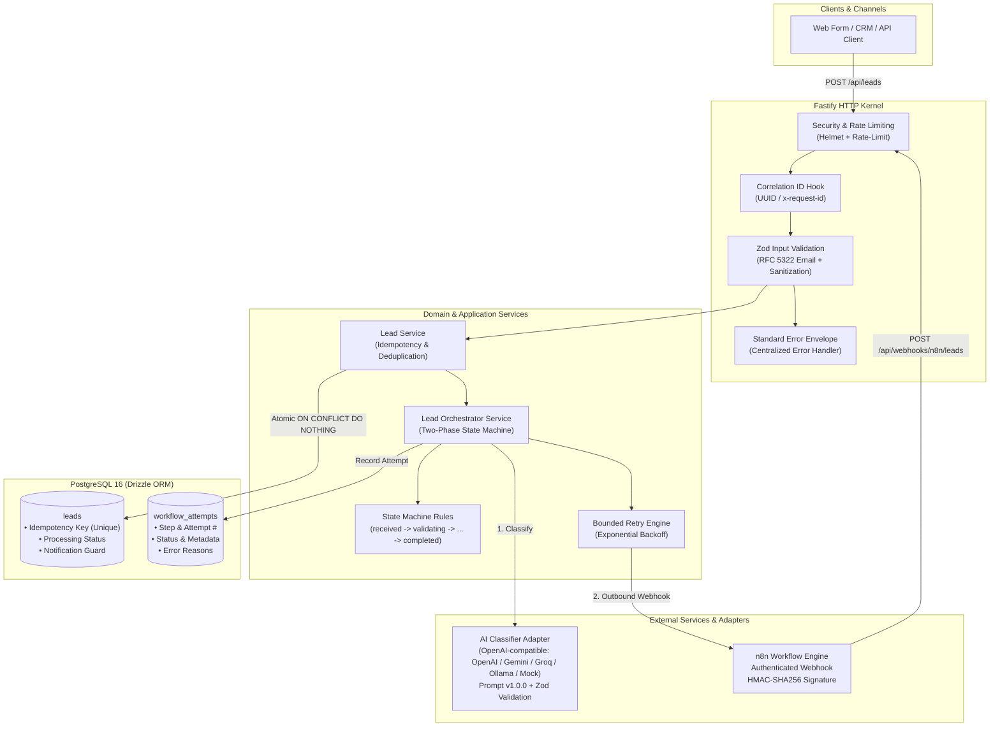
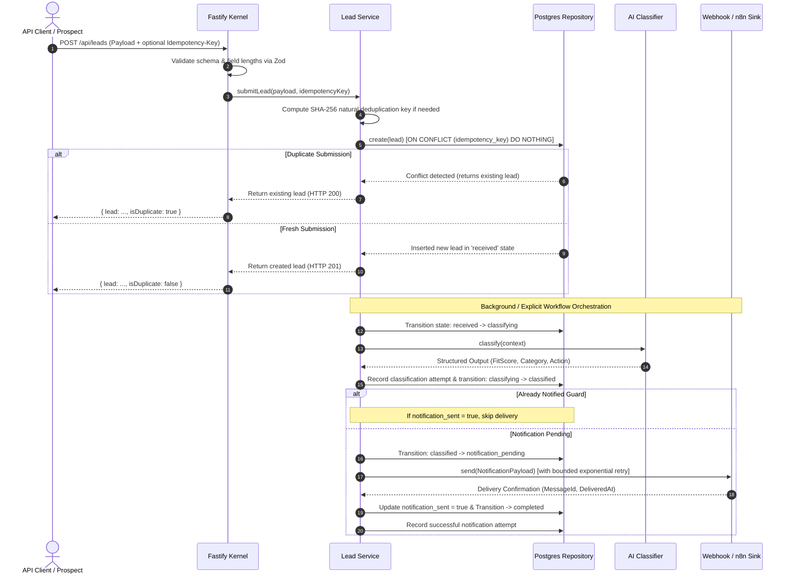

# Architecture Documentation

## 1. Executive Summary

The **AI Business Automation Platform** is a production-grade backend service designed to automate B2B lead intake, AI-powered fit classification, and workflow orchestration. The architecture prioritizes durability, deterministic idempotency, security hardening, and observability.

---

## 2. System Architecture Diagram

---

## 3. End-to-End Processing Sequence

---

## 4. Architectural Boundaries and Component Responsibilities

### 4.1 HTTP & API Kernel (`src/http/`, `src/routes/`, `src/app.ts`)

- **Fastify Kernel**: High-performance HTTP server running on strict `NodeNext` ESM.
- **Security Middleware**: `@fastify/helmet` injects defensive HTTP headers; `@fastify/rate-limit` enforces a 100 req/min per-IP ceiling; `bodyLimit: 104857` prevents memory exhaustion via 100 KB payload limits.
- **Correlation Tracking**: Injects `x-request-id` into all response headers and echoes correlation IDs in every success or error response envelope.
- **Centralized Error Handling**: Transforms domain exceptions (`AppError`, `NotFoundError`, `ConflictError`, `ValidationError`) into standardized `{ error: { code, message, correlationId } }` envelopes without leaking internal stack traces.

### 4.2 Domain & State Machine (`src/domain/`)

- **Finite State Machine (`src/domain/workflows/state-machine.ts`)**:
  Enforces deterministic state transitions:
  $$\text{received} \longrightarrow \text{validating} \longrightarrow \text{classifying} \longrightarrow \text{classified} \longrightarrow \text{notification\_pending} \longrightarrow \text{completed}$$
  Failed states transition strictly to `failed` and can only be resumed via explicit retry transitions.
- **Retry Policy (`src/domain/workflows/retry-policy.ts`)**:
  Distinguishes transient errors (HTTP 429, 500, 502, 503, 504, timeouts) from permanent errors (validation errors, invalid states). Implements bounded exponential backoff with jitter.

### 4.3 Persistence & Idempotency Layer (`src/adapters/database/`)

- **PostgreSQL 16 & Drizzle ORM**: Fully parameterized type-safe queries preventing SQL injection.
- **Deterministic Deduplication**: Client can provide an explicit `Idempotency-Key` HTTP header. If omitted, the platform computes a deterministic natural deduplication hash:
  $$\text{idempotency\_key} = \text{SHA-256}(\text{normalizedEmail} + \text{":"} + \text{normalizedMessage})$$
- **Atomic Concurrency Control**: Uses database-level unique constraints (`ON CONFLICT (idempotency_key) DO NOTHING`) to eliminate race conditions between concurrent requests.
- **Durable Audit Trail (`workflow_attempts`)**: Logs each execution step, retry number, status (`retrying`, `success`, `failed`), and error reasons for full post-incident traceability.

### 4.4 AI Classification Layer (`src/domain/classification/`, `src/adapters/llm/`)

- **Provider-Independent Interface (`LeadClassifier`)**: Decouples application logic from specific LLM providers.
- **Config-Driven Factory (`classifier.factory.ts`)**: Selects the active provider at startup via `LLM_PROVIDER`. `mock` (default) is deterministic for CI; `openai` targets any OpenAI-compatible endpoint (`OPENAI_BASE_URL` + `OPENAI_MODEL`), including free providers like Google Gemini, Groq, and local Ollama.
- **Strict Output Parsing (`ClassifierOutputSchema`)**: LLM output is treated as untrusted data. Responses are validated against strict Zod schemas with controlled category and action enums.
- **Safety Controls**: Prompt versioning (`v1.0.0`), token budgets (`maxTokens: 300`), temperature controls (`0.2`), and `AbortController` timeouts (10s max).

### 4.5 n8n Workflow Automation (`src/adapters/notifications/`, `workflows/`)

- **Authenticated Webhooks**: Inbound requests require timing-safe `X-Webhook-Secret` verification. Outbound webhooks include `X-Webhook-Signature` HMAC-SHA256 digests.
- **Business Rule Isolation**: Core lead state transitions and duplicate checks stay within the TypeScript backend; n8n handles routing, CRM sync, and external notifications.

---

## 5. Security & Observability Architecture

- **Pino Structured Redaction**: Secret tokens, passwords, cookies, and webhook secrets are automatically redacted to `[REDACTED]` before leaving memory.
- **Zero-Credential Workflow Exports**: Exported n8n workflows (`workflows/lead-automation-workflow.json`) use environment variable references and sanitized templates.
