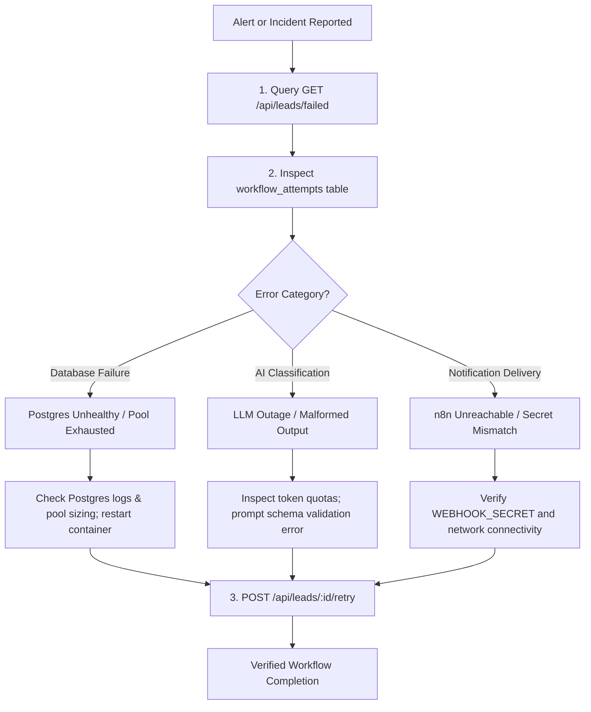

# Troubleshooting & Incident Recovery Guide

## 1. Triage Workflow



---

## 2. Common Scenarios & Remediation

### Scenario 1: A Lead is Stuck in `failed` Status

- **Symptom**: Lead status is `failed` and `failure_reason` is populated in the database.
- **Root Cause Analysis**:
  1. Fetch failed leads:
     ```bash
     curl -s http://localhost:3000/api/leads/failed | jq .
     ```
  2. Inspect the audit attempts in PostgreSQL:
     ```sql
     SELECT step, attempt_number, status, error_message, created_at
     FROM workflow_attempts
     WHERE lead_id = '<LEAD_ID>'
     ORDER BY attempt_number ASC;
     ```
- **Remediation**:
  Once the underlying provider or network condition is resolved, trigger safe retry:
  ```bash
  curl -X POST http://localhost:3000/api/leads/<LEAD_ID>/retry
  ```
  _Note: If notifications were already delivered before the failure occurred, the platform automatically skips duplicate notification delivery._

---

### Scenario 2: Webhook Unauthorized (`401 UNAUTHORIZED`)

- **Symptom**: Webhook calls from n8n return HTTP 401 with `UNAUTHORIZED`.
- **Root Cause**:
  - The incoming `X-Webhook-Secret` header does not match the server's configured `WEBHOOK_SECRET`.
  - Or the header was omitted by the caller.
- **Remediation**:
  1. Verify the `WEBHOOK_SECRET` environment variable configured on both services.
  2. Confirm timing-safe equality matches:
     ```bash
     curl -i -X POST http://localhost:3000/api/webhooks/n8n/leads \
       -H "Content-Type: application/json" \
       -H "X-Webhook-Secret: <CORRECT_SECRET>" \
       -d '{"name":"Test","email":"test@example.com","message":"Need help"}'
     ```

---

### Scenario 3: Database Connection Refusal (`ECONNREFUSED` / Pool Exhaustion)

- **Symptom**: Requests return HTTP 500 with `INTERNAL_SERVER_ERROR`. Server logs display connection refusal to port 5432.
- **Remediation**:
  1. Check PostgreSQL container health:
     ```bash
     docker compose ps postgres
     ```
  2. Check PostgreSQL container logs:
     ```bash
     docker compose logs --tail=50 postgres
     ```
  3. Ensure max connections has not been exceeded in PostgreSQL:
     ```sql
     SELECT count(*), state FROM pg_stat_activity GROUP BY state;
     ```

---

### Scenario 4: LLM Provider Timeout or Rate Limiting

- **Symptom**: Workflow attempt fails with message `LLM provider request timed out after 10000ms.` or HTTP 429 from LLM API.
- **Remediation**:
  1. The platform automatically attempts bounded exponential backoff retries (up to 2 retries with backoff up to 4s).
  2. If all retries exhaust, the lead transitions cleanly to `failed` without crashing the application.
  3. Inspect rate limit ceilings or credit balances on the LLM provider account.
  4. Trigger `/api/leads/:id/retry` once provider quotas reset.

---

### Scenario 5: Client Hits Rate Limit (`429 RATE_LIMIT_EXCEEDED`)

- **Symptom**: Client receives HTTP 429 with:
  ```json
  {
    "error": {
      "code": "RATE_LIMIT_EXCEEDED",
      "message": "Rate limit exceeded, retry in ...",
      "correlationId": "..."
    }
  }
  ```
- **Remediation**:
  - The default limit is 100 requests per minute per IP.
  - Client should implement exponential backoff or aggregate batch submissions.
  - In trusted internal environments, adjust the rate limit window in `buildApp({ rateLimit: { max: 1000 } })`.
